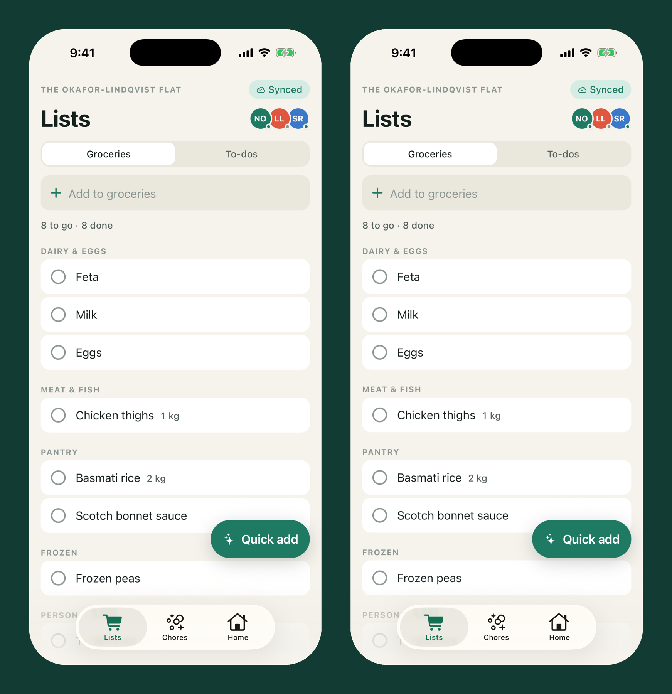
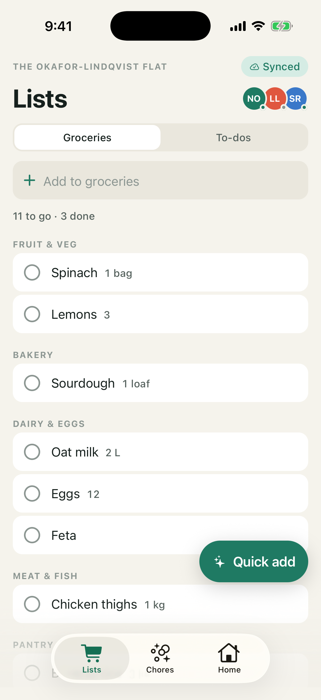
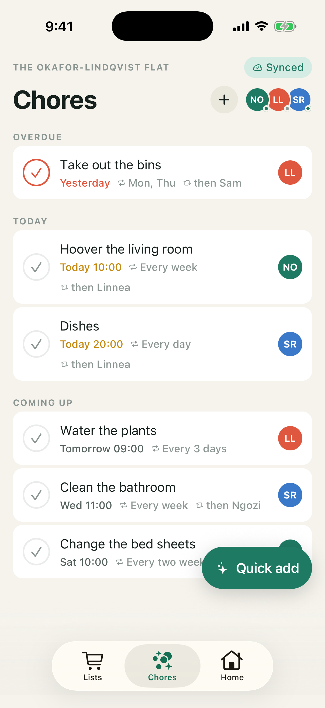
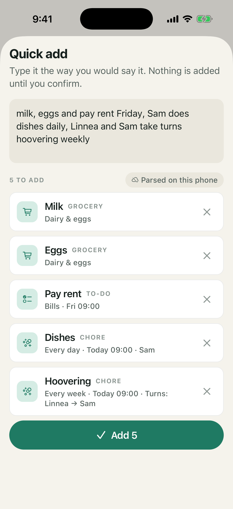
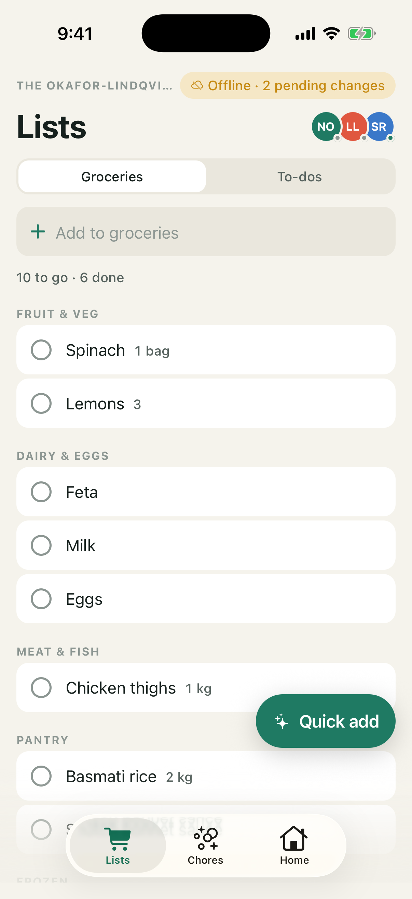
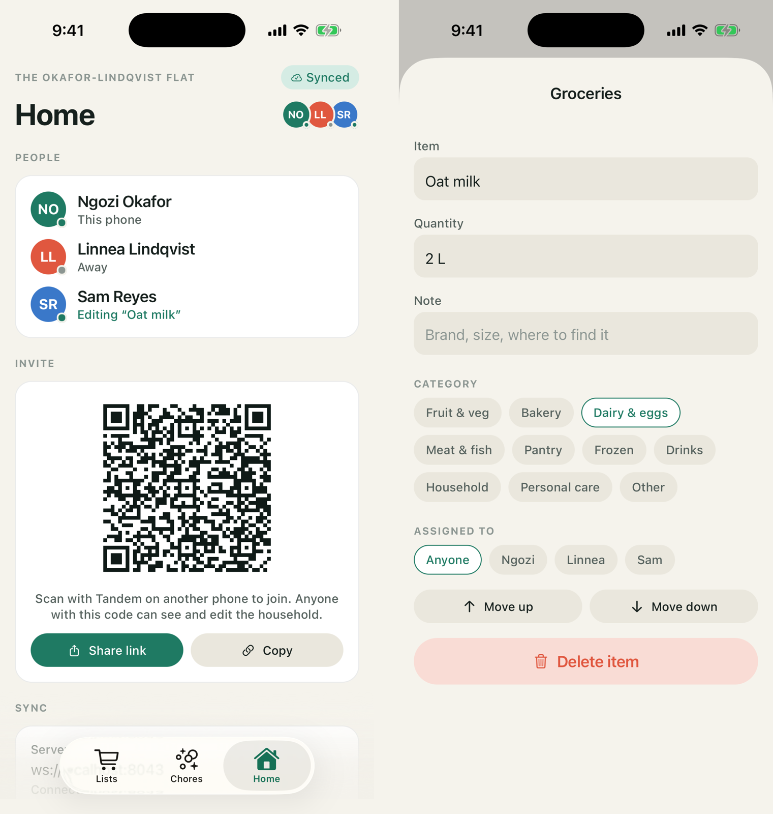
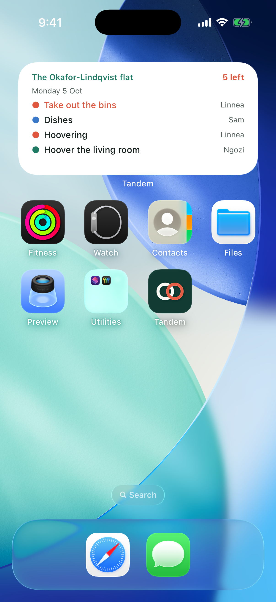
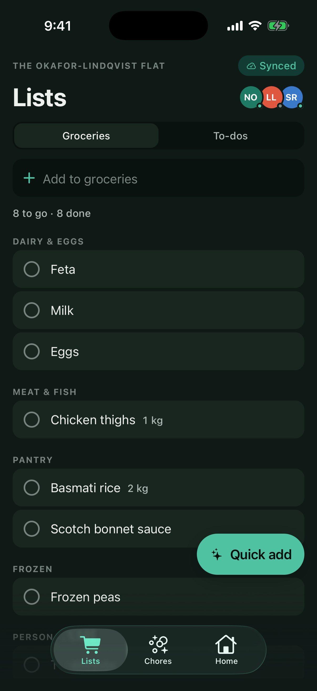
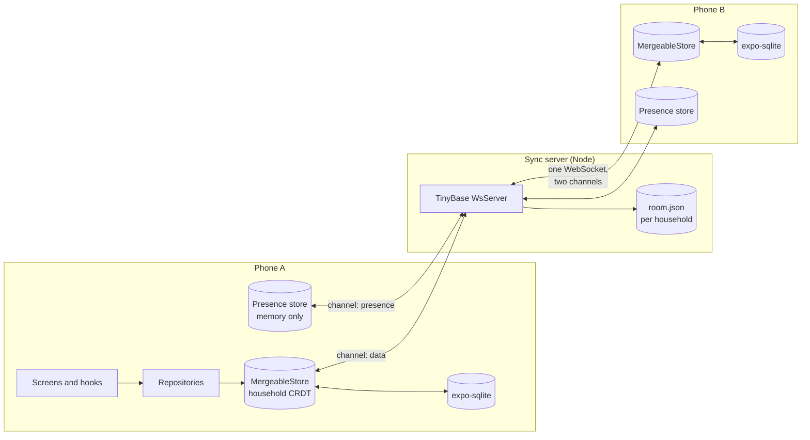
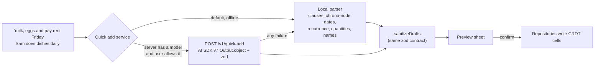

# Tandem

**A local-first household planner for iOS and Android.** Shared groceries, to-dos and chores work fully offline, sync in real time across everyone's phones, and merge concurrent edits without conflicts. Quick add turns _"milk, eggs and pay rent Friday, Sam does dishes daily"_ into categorised items, due dates, assignees and recurring chores.

[](https://github.com/OwaisMunawar/tandem/actions/workflows/ci.yml)


[](LICENSE)

<p align="center">
  
</p>
<p align="center"><sub>Two simulators on one household after an offline edit on each and a server restart. Same data, both synced.</sub></p>

|                                          Lists                                           |                                                          Chores with rotation                                                          |                                            Quick add preview                                             |                                       Offline with pending changes                                       |
| :--------------------------------------------------------------------------------------: | :------------------------------------------------------------------------------------------------------------------------------------: | :------------------------------------------------------------------------------------------------------: | :------------------------------------------------------------------------------------------------------: |
|  |  |  |  |

|                                              Presence: Sam is editing "Oat milk"                                               |                                                 Home-screen widget                                                  |                                  Dark mode                                   |
| :----------------------------------------------------------------------------------------------------------------------------: | :-----------------------------------------------------------------------------------------------------------------: | :--------------------------------------------------------------------------: |
|  |  |  |

All screenshots are real captures from two iPhone 17 Pro simulators (iOS 26.5) running the development build against a local sync server.

## Why

Household apps break the moment the Wi-Fi does. You open the shopping list in a supermarket basement and get a spinner; you tick something off on the train and it silently never arrives; two people edit the list at once and one of them loses.

Local-first fixes that by flipping the architecture. Every phone keeps the whole household in a CRDT document on disk and reads and writes it instantly. Syncing is something that happens in the background when a connection exists, and merging is a property of the data, not a server-side referee. The server only relays and stores. If it disappears, nothing is lost.

## Features

- **Households.** Create one, invite people with a QR code or a `tandem://join` link, pick member names and colours, leave without breaking anyone's history.
- **Lists.** Groceries grouped in aisle order and to-dos grouped by kind, with quantities, notes, assignees and due dates. Swipe right to tick, left to delete, undo from the toast. Reorder with fractional positions.
- **Chores.** Daily, weekly or custom-day schedules, a take-turns rotation, and completion that schedules the next occurrence in the household's time zone.
- **Real-time and offline.** A sync pill that always tells the truth (synced, syncing, offline with N pending changes, paused), presence dots, and a live "Linnea is editing" badge on rows.
- **Conflict-free merges.** Field-level last-writer-wins with hybrid logical clocks. Concurrent additions are all kept. Proven by tests, not promised.
- **Quick add.** An offline rule-based parser by default, an optional LLM parser on your own server, and a confirm-first preview either way.
- **iOS widget** for today's chores, plus **local reminders** for what is yours.
- **Demo mode.** `EXPO_PUBLIC_DEMO=1` seeds _The Okafor-Lindqvist flat_ (three people, 26 items and chores) and runs with no server.

## Architecture



Each household is one room on the server. A phone loads its household from SQLite first, renders immediately, then connects. `SyncSession` multiplexes the household and the ephemeral presence document over one WebSocket and rebuilds both synchronizers after every drop, with jittered backoff.



Feature-first layout: `src/features/{households,lists,chores,sync,quick-add,widget,reminders}`, shared `src/core` (store, schema, theme, UI library, errors), thin routes in `src/app`. Domain code in `lib/` folders is pure TypeScript, enforced by ESLint, so the server bundles the same quick-add contract the app uses. Decisions and rejected alternatives (Zero, Instant, PowerSync, Automerge) are in [docs/ARCHITECTURE.md](docs/ARCHITECTURE.md).

## How merges work

Every cell in the household document is a register stamped with a hybrid logical clock. Merging takes the newer stamp per cell. In practice:

| Phone A (offline)                 | Phone B (offline)                    | After both sync                                                     |
| --------------------------------- | ------------------------------------ | ------------------------------------------------------------------- |
| Renames "Milk" to "Oat milk"      | Ticks "Milk" and sets quantity "2 L" | **Oat milk · 2 L · done**: different fields, both kept              |
| Sets quantity "2 L" at 10:00      | Sets quantity "1 L" at 10:05         | **1 L**: same field, later edit wins, whoever syncs first           |
| Adds "Eggs" and "Bread"           | Adds "Coffee"                        | **All three**: new rows never collide                               |
| Completes "Dishes" (Sam → Linnea) | Completes "Dishes" a minute later    | **One next occurrence**, Linnea's turn: both computed the same plan |
| Deletes "Milk", then taps Undo    | –                                    | **Milk is back** everywhere: undo is a later write                  |

Things that must change together (a chore's recurrence rule, its rotation) are stored as one cell, so they are replaced whole rather than half-merged. Text fields commit on blur, so a title is never a character-level blend of two people's typing. See [`mergeConvergence.test.ts`](src/features/sync/__tests__/mergeConvergence.test.ts) and the real-socket suite in [`server/src/__tests__/sync.test.ts`](server/src/__tests__/sync.test.ts).

## Tech stack

| Area                 | Choice                                                                                                                                         |
| -------------------- | ---------------------------------------------------------------------------------------------------------------------------------------------- |
| App                  | Expo SDK 57, React Native 0.86, React 19.2, Expo Router (native tabs), React Compiler, development build                                       |
| Local-first sync     | TinyBase 10 `MergeableStore`, expo-sqlite persister, WebSocket synchronizer with channels                                                      |
| Server               | Node 22, TinyBase `WsServer`, file persistence per room, `ws`, esbuild bundle, Docker                                                          |
| Quick add            | Rule-based parser with chrono-node; optional Vercel AI SDK v7 `generateText` + `Output.object`, zod 4                                          |
| Widget and reminders | `expo-widgets` with `@expo/ui` SwiftUI components, `expo-notifications`                                                                        |
| UI                   | Reanimated 4 layout animations, Gesture Handler swipeable rows, design tokens with light and dark themes                                       |
| Invites              | `qrcode` matrix rendered with plain Views, `expo-camera` barcode scanning, deep links                                                          |
| Quality              | TypeScript strict + `noUncheckedIndexedAccess`, ESLint (eslint-config-expo), Prettier, Jest (jest-expo), React Native Testing Library, Maestro |

## Quick start

```sh
npm install
npm run server                         # sync server on ws://localhost:8043
EXPO_PUBLIC_DEMO=1 EXPO_PUBLIC_SYNC_URL=ws://localhost:8043 npx expo run:ios
```

`run:ios` (or `run:android`) builds the development client once and starts Metro. Leave out `EXPO_PUBLIC_SYNC_URL` and demo mode runs as a local-only household with no server. To try sync, open the Home tab on one device and scan its QR code, or open the invite link, on another. The Android emulator reaches your machine at `ws://10.0.2.2:8043`.

## Self-hosting the sync server

The server is one Node process with no database.

```sh
docker build -f server/Dockerfile -t tandem-sync .
docker run -d -p 8043:8043 -v tandem-data:/data tandem-sync
curl localhost:8043/health        # {"ok":true,"rooms":0,"clients":0}
```

| Variable               | Default                      | Purpose                                                                    |
| ---------------------- | ---------------------------- | -------------------------------------------------------------------------- |
| `PORT`                 | `8043`                       | HTTP and WebSocket port                                                    |
| `DATA_DIR`             | `./data` (`/data` in Docker) | One JSON file per household, including CRDT metadata                       |
| `QUICK_ADD_MODEL`      | empty                        | An AI Gateway model id such as `openai/gpt-5-mini` to enable LLM quick add |
| `AI_GATEWAY_API_KEY`   | empty                        | Key for the gateway when a model is set                                    |
| `QUICK_ADD_RATE_LIMIT` | `20`                         | Quick-add requests per minute per client address                           |

Put it behind a TLS-terminating proxy (Caddy, nginx) and point the app at `wss://your-host`. **There is no authentication in v0.1:** a household's 132-bit random room id is the only credential, so anyone with an invite can read and write it. The full trust model is in [ADR-004](docs/ARCHITECTURE.md#adr-004-server-trust-model-v01).

## Quality

```sh
npm run format:check && npm run lint && npm run typecheck && npm run test:coverage
```

- **209 tests** across the app and the server. Coverage on domain, data and sync code is gated at 90% lines in CI (currently 99% lines, 90% branches).
- **Merge-convergence suite**: two and three simulated phones with controlled clocks, edits offline, gossip in different orders, assert identical content.
- **Server sync tests** run the app's own `SyncSession` against a real `WsServer` on a real port: live sync, room isolation, pause and resume with pending counts, and a server restart that phones recover from on their own, with data reloaded from disk.
- **Time-zone tests** for DST gaps and overlaps in London, New York and Sydney.
- **Screen tests** render real screens over the real composition root with in-memory storage.
- **Maestro flows** in [`.maestro/`](.maestro) for the demo happy path.
- **CI**: format, lint, typecheck, tests with coverage, `expo-doctor`, a Docker build and smoke test of the server, an iOS simulator build on macOS and an Android debug assemble. Every action is pinned to a release tag.

## Roadmap

- Signed invites and per-room keys, so a leaked link can be revoked.
- End-to-end encryption of room snapshots on the server.
- Several households per device.
- Android home-screen widget (Glance); `expo-widgets` is iOS-only today.
- Drag-to-reorder (moves are already conflict-free; today they use buttons and accessibility actions).
- History and "who changed this", built on the CRDT timestamps already stored.

---

Built by [Owais Munawwar](https://github.com/OwaisMunawar). I'm available for React Native, AI and iOS work on [Upwork](https://www.upwork.com/freelancers/owaism11).
